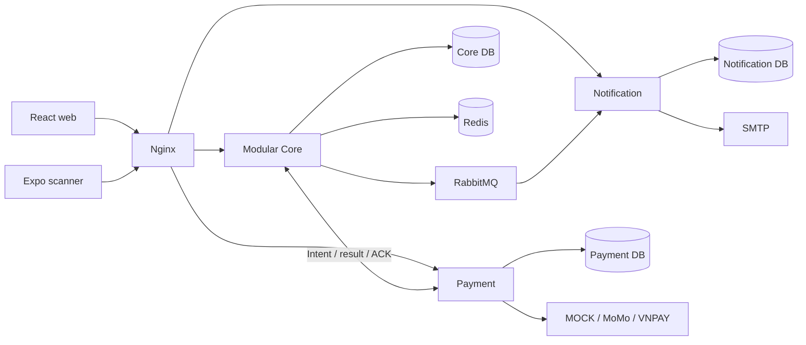

# TicketBox

A concert ticketing platform built with a modular Java backend, independent payment and notification services, a React web app, and an offline-capable Expo scanner.

The project focuses on the difficult parts of ticket sales: admission control, concurrent inventory updates, idempotent checkout, payment reconciliation, durable messaging and gate check-in.

## Features

- **Audience:** browse concerts, enter a waiting room, reserve ticket quantities, recover interrupted checkout, pay through MOCK/MoMo/VNPAY adapters and view QR e-tickets.
- **Organizer:** manage owned concerts and ticket types, import guest lists from CSV, review AI-generated artist biographies, inspect sales and export revenue reports.
- **Staff:** scan QR tickets online, download an offline dataset, sync check-in logs and handle guest-list attendance.
- **Admin:** manage accounts, concert/order/ticket operations, notification retries and payment compensation reviews.

## Quick start

Requires Docker Desktop with Compose v2. Run from the repository root:

```sh
docker compose up -d --build
```

Open **http://localhost:18091**. The first build downloads Java/Node dependencies; wait for Core startup before signing in. Check readiness at **http://localhost:18091/api/health**.

No host Java installation or prebuilt artifacts are needed. Compose includes the web gateway, three backend applications, three PostgreSQL databases, Redis, RabbitMQ and a local SMTP sink. Defaults use MOCK payment and mock artist biographies; external provider keys are optional. Copy `.env.example` to `.env` to customize addresses or integrations.

| Demo role | Email | Password |
| --- | --- | --- |
| Audience | `audience@ticketbox.com` | `password123` |
| Organizer | `organizer@ticketbox.com` | `password123` |
| Staff | `staff@ticketbox.com` | `password123` |
| Admin | `admin@ticketbox.com` | `password123` |

These are local demo accounts. SMTP accepts messages locally without delivering them externally.

```sh
node scripts/smoke.mjs                   # Web, catalog, role login and notification checks
docker compose logs -f core payment notification
docker compose down                     # Stop services; retain named data volumes
```

## Architecture



Core contains ten business modules. Transactional inventory, holds, orders, ticket issuance and check-in stay together; Payment and Notification own their databases and communicate through versioned contracts. Embedded implementations remain in Core for compatibility with its migration history.

- PostgreSQL conditional stock updates and per-user/concert guards protect inventory and account limits.
- Redis admission budgets regulate how many shoppers enter checkout. STOMP/SockJS provides queue updates.
- Durable payment intents, result outbox/inbox deduplication and persisted ACKs support retries without issuing duplicate tickets.
- RabbitMQ notifications recover after outages. Database delivery leases coordinate workers; SMTP remains at least once.
- Spring Modulith architecture tests enforce module boundaries. Testcontainers covers real database/broker/Redis behavior.

Read the [architecture](docs/architecture.md) for transaction boundaries, ownership and recovery details.

## Stack

| Area | Technology |
| --- | --- |
| Backend | Java 21, Spring Boot 3.3, Spring Modulith, Spring Security/JWT |
| Persistence | PostgreSQL 16, JPA/JDBC, Flyway, Spring Batch |
| Messaging and resilience | RabbitMQ, Redis 7, Resilience4j, ShedLock |
| Web | React 18, TypeScript, Vite, Tailwind CSS |
| Scanner | Expo, React Native, SQLite |
| Delivery and operations | Docker Compose, Nginx, Actuator/Micrometer, optional Prometheus/Grafana |

## Repository

```text
backend/           Modular Core application and integration tests
services/          Independent payment and notification applications
frontend/          React web application
mobile-scanner/    Expo scanner and offline synchronization
contracts/         Versioned integration schemas
infra/             Gateway, database initialization, SMTP and monitoring config
scripts/           Verification, smoke and isolated end-to-end tests
docs/              Architecture, development and API guides
compose.yaml       Default local deployment
```

## Verification and documentation

```sh
pwsh -File scripts/ci/verify.ps1          # All Java suites, web lint/build, scanner typecheck
pwsh -File scripts/e2e/run.ps1 -Build     # Isolated distributed workflow and fault tests
```

Java integration tests require Docker. PowerShell 7 runs the shared verification scripts; Node.js 24 is used for local web/scanner development and smoke checks. See [development and testing](docs/development.md) for individual commands, browser regression, restore rehearsal and optional monitoring.

- [Architecture and consistency](docs/architecture.md)
- [Development and testing](docs/development.md)
- [API guide](docs/api.md)
- [Mobile scanner](mobile-scanner/README.md)

## Scope

The default deployment is for local development and demonstration. Real merchant sandbox certification, automated provider refunds, large-scale capacity acceptance and multi-device offline field testing remain outside the verified scope. A transferred/refunded enum value is not a complete transfer/refund workflow. The project does not claim production readiness or 80,000-user capacity.
