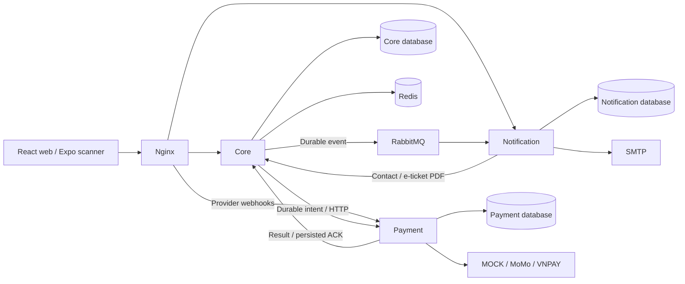

# Architecture

TicketBox keeps transactional ticketing in a modular Spring Boot Core and runs Payment and Notification as independent applications. The default Compose deployment uses a separate PostgreSQL database for each application.

## Core modules

| Module | Responsibility |
| --- | --- |
| `auth` | Accounts, BCrypt credentials, JWTs, profiles and roles |
| `concert` | Concert lifecycle, sale windows, ticket-type metadata, posters and content |
| `inventory` | Operational stock in `ticket_inventory` |
| `queue` | Waiting room, randomized opening queue, FIFO arrivals, admission and shopping sessions |
| `ticket` | Holds, orders, expiry, payment intents, ticket issuance and PDF documents |
| `payment` | Embedded implementation and remote Payment adapter |
| `notification` | Embedded implementation and Core-owned reminder scheduling |
| `checkin` | Online check-in, offline dataset/sync and scan history |
| `admin` | Guest-list CSV imports, guest attendance and organizer revenue reports |
| `ai` | PDF-to-biography jobs, recovery and organizer-reviewed drafts |

Modules expose ports and views from their root packages. Other modules use those APIs instead of importing internal entities or repositories. `ModularityTest` verifies the declared Spring Modulith boundaries. Infrastructure adapters and shared contracts live outside the business modules.

## Purchase consistency

1. Queue admission creates a user/concert shopping token in Redis. The default session lasts ten minutes. Opening-time entrants are randomized; later arrivals join the FIFO queue.
2. PostgreSQL `purchase_guards` serialize a user's hold/order changes for a concert. Stock reservations use conditional updates and cannot decrement below zero.
3. Order creation checks account limits and server-side prices, converts holds to allocations and snapshots the order items. Orders expire after fifteen minutes. Cancellation/expiry returns stock in a local transaction.
4. Idempotency keys protect order creation. An authenticated lookup by key recovers a committed order after a lost response.
5. Ticketing persists an immutable payment intent before remote calls. Payment persists its attempt before provider I/O and retains the original request identity after ambiguous timeouts.
6. A verified provider success creates a durable result outbox entry. Core validates the result against its intent, deduplicates it and commits the paid order, tickets and notification publication together. The ACK is persisted; replay does not issue more tickets.
7. Success for an expired/cancelled order creates a compensation review. It does not reclaim released stock. Manual refund records are operator evidence; the application does not automatically refund through providers.

The stock invariant for a normal sale is `total = available + held + allocated`, where allocated includes awaiting-payment and paid order items. Some legacy catalog seeds contain illustrative sales without corresponding orders; use newly created sales for strict invariant checks.

## Messaging and recovery

- Core's Modulith publication log survives broker outages. RabbitMQ publishing uses confirms; notification consumers commit inbox deduplication with notification rows.
- Email delivery uses owner-fenced database leases. SMTP runs outside database transactions and is at least once: a crash after SMTP acceptance can cause a duplicate email.
- Payment dispatch/result workers use leases and retries. Uncertain attempts are queried using the original identity instead of creating a new charge.
- Redis is the queue/session authority, not the stock authority. Redis outages reject purchase mutations. Loss of Redis state invalidates old shopping tokens.
- Queue admission hints use Redis Pub/Sub across Core replicas. STOMP/SockJS delivers updates; periodic status refresh compensates for missed hints.
- Online check-in atomically changes a valid ticket to used and records the accepted scan. Offline devices reconcile when syncing and can conflict before that point.

## Contracts and deployment boundaries

`contracts/` contains versioned JSON schemas for payment intents, results, ACKs and notification commands. Stable event/request IDs are retained across retries. Internal HTTP uses dedicated service tokens; provider callbacks verify signatures. The public gateway blocks internal and actuator routes.

Core retains legacy embedded implementations and historical migrations. In remote mode, database fencing prevents old Payment/Notification writers from modifying their former tables. After remote transactions exist, changing routing alone is not a safe rollback.

The supplied Compose configuration is a single-host development deployment with demo credentials. Real merchant certification, production failover, signing-key rotation, multi-device field testing and large-scale capacity acceptance remain separate work. No 80,000-user capacity claim is made.
