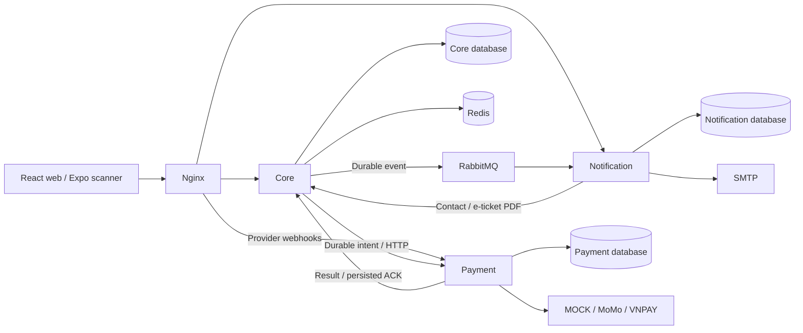

# Architecture

The default deployment runs Identity, Catalog, Ticketing, Check-in, Payment and Notification with six separate PostgreSQL instances. The [service extraction guide](service-extraction.md) defines current ownership, durable configuration/ticket delivery, LAN admission and the offline cutover procedure. The Core diagram below records the architecture before Phase 2–4 and remains the reference for the legacy deployment.

## Core modules

| Module | Responsibility |
| --- | --- |
| `auth` | Accounts, BCrypt credentials, JWTs, profiles and roles |
| `concert` | Concert lifecycle, sale windows, ticket-type metadata, posters and content |
| `inventory` | Operational stock in `ticket_inventory` |
| `queue` | Waiting room, randomized opening queue, FIFO arrivals, admission and shopping sessions |
| `ticket` | Holds, orders, expiry, payment intents, ticket issuance and PDF documents |
| `payment` | Embedded implementation and remote Payment adapter |
| `notification` | Embedded implementation and Core-owned reminder scheduling |
| `checkin` | Online check-in, offline dataset/sync and scan history |
| `admin` | Guest-list CSV imports, guest attendance and organizer revenue reports |
| `ai` | PDF-to-biography jobs, recovery and organizer-reviewed drafts |

Modules expose ports and views from their root packages. Other modules use those APIs instead of importing internal entities or repositories. `ModularityTest` verifies the declared Spring Modulith boundaries. Infrastructure adapters and shared contracts live outside the business modules.

## Purchase consistency

1. Queue admission creates a user/concert shopping token in Redis. The default session lasts ten minutes. Opening-time entrants are randomized; later arrivals join the FIFO queue.
2. PostgreSQL `purchase_guards` serialize a user's hold/order changes for a concert. Stock reservations use conditional updates and cannot decrement below zero.
3. Order creation checks account limits and server-side prices, converts holds to allocations and snapshots the order items. Orders expire after fifteen minutes. Cancellation/expiry returns stock in a local transaction.
4. Idempotency keys protect order creation. An authenticated lookup by key recovers a committed order after a lost response.
5. Ticketing persists an immutable payment intent before remote calls. Payment persists its attempt before provider I/O and retains the original request identity after ambiguous timeouts.
6. A verified provider success creates a durable result outbox entry. Core validates the result against its intent, deduplicates it and commits the paid order, tickets and notification publication together. The ACK is persisted; replay does not issue more tickets.
7. Success for an expired/cancelled order creates a compensation review. It does not reclaim released stock. Manual refund records are operator evidence; the application does not automatically refund through providers.

The stock invariant for a normal sale is `total = available + held + allocated`, where allocated includes awaiting-payment and paid order items. Some legacy catalog seeds contain illustrative sales without corresponding orders; use newly created sales for strict invariant checks.

## Messaging and recovery

- Core's Modulith publication log survives broker outages. RabbitMQ publishing uses confirms; notification consumers commit inbox deduplication with notification rows.
- Email delivery uses owner-fenced database leases. SMTP runs outside database transactions and is at least once: a crash after SMTP acceptance can cause a duplicate email.
- Payment dispatch/result workers use leases and retries. Uncertain attempts are queried using the original identity instead of creating a new charge.
- Redis is the queue/session authority, not the stock authority. Redis outages reject purchase mutations. Loss of Redis state invalidates old shopping tokens.
- Queue admission hints use Redis Pub/Sub across Core replicas. STOMP/SockJS delivers updates; periodic status refresh compensates for missed hints.
- Online check-in atomically changes a valid ticket to used and records the accepted scan. Offline devices reconcile when syncing and can conflict before that point.

## Contracts and deployment boundaries

`contracts/` contains versioned JSON schemas for payment intents, results, ACKs and notification commands. Stable event/request IDs are retained across retries. Internal HTTP uses dedicated service tokens; provider callbacks verify signatures. The public gateway blocks internal and actuator routes.

Core retains legacy embedded implementations and historical migrations. In remote mode, database fencing prevents old Payment/Notification writers from modifying their former tables. After remote transactions exist, changing routing alone is not a safe rollback.

The supplied Compose configuration is a single-host development deployment with demo credentials. Real merchant certification, production failover, signing-key rotation, multi-device field testing and large-scale capacity acceptance remain separate work. No 80,000-user capacity claim is made.

## Order event sourcing — đợt 1

Core dùng PostgreSQL cho order streams. Migration V34 tạo `order_events` và nhập đơn cũ thành `OrderImported` ở phiên bản 1. Snapshot chứa dữ liệu đơn và dòng hàng tại lúc cutover. Các trạng thái trước thời điểm đó không thể tái tạo từ snapshot.

Order mới bắt đầu với `OrderCreated`. Các thay đổi sau đó append patch có kiểu và phiên bản, gồm khởi tạo thanh toán, thanh toán thành công, hết hạn và hủy. Các command giữ row lock trên `orders`, đọc lại trạng thái vòng đời từ stream, rồi append với expected version. Khóa chính chặn hai lần ghi cùng phiên bản. `orders` và `order_items` là projection đồng bộ để giữ API, truy vấn quota và các FK hiện hành. Stock, ledger thanh toán, vé và hàng đợi thông báo vẫn có vòng đời riêng.

Giữ transaction hiện hành cho stock, append và projection. Khi chấp nhận thanh toán, việc phát hành vé, inbox ACK và publication cho thông báo vẫn nằm trong transaction xử lý kết quả. Replay SQL chỉ dựng dữ liệu Order. Nó không gọi provider, ghi stock, tạo vé hoặc phát sự kiện ra broker.

Dừng toàn bộ Core writer cũ trước khi chạy Flyway. Sao lưu DB, diễn tập V34 trên bản sao và kiểm tra replay trước khi mở writer mới. Không chạy song song phiên bản trước/sau V34 trên cùng DB. Sau khi phiên bản mới nhận ghi, khôi phục bằng backup đã đối chiếu hoặc sửa tiến về phía trước để giữ lịch sử sự kiện. Chạy `psql -v ON_ERROR_STOP=1 -f scripts/db/verify-order-replay.sql` trên DB mục tiêu bằng quyền đọc và tạo bảng tạm. Script dựng bảng tạm tại một snapshot nhất quán, đối chiếu từng đơn và rollback. Bảng đọc hiện hành chưa bị hoán đổi tự động.
