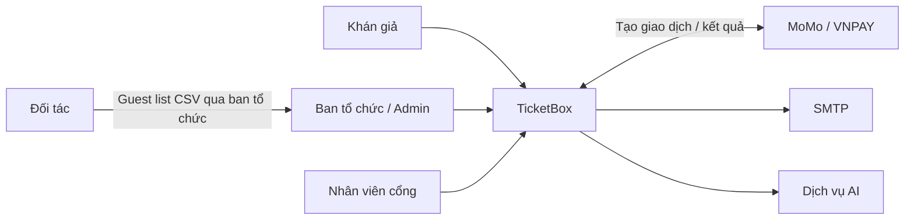
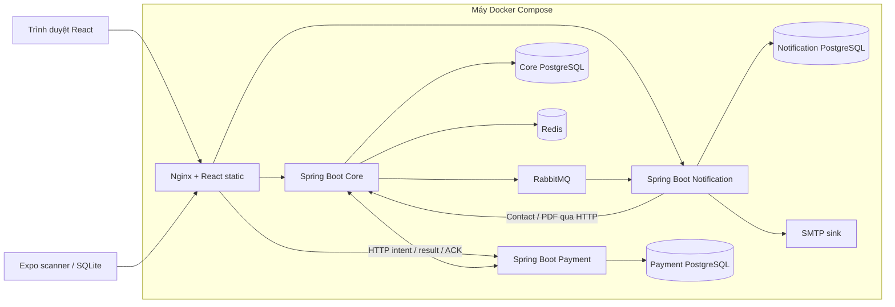
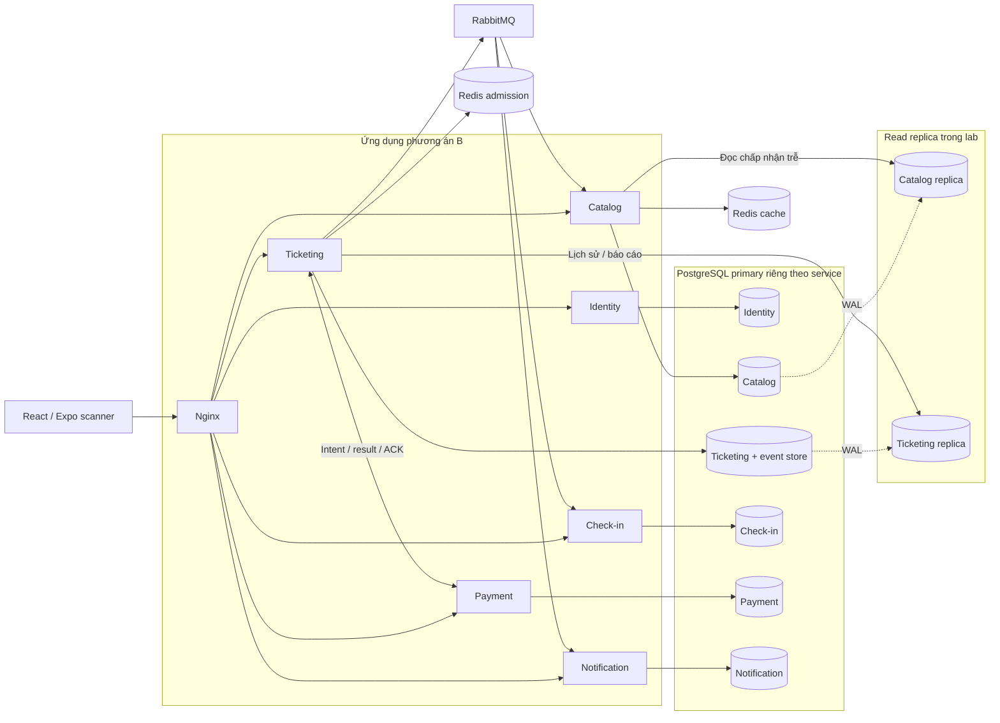

# TicketBox — Blueprint đợt 0

Baseline mã nguồn: `c06e085`. Đường triển khai mặc định nằm trong Compose. Xem [kiến trúc hiện tại](architecture.md), [API](api.md) và [lộ trình](superpowers/plans/2026-11-03-ticketbox-phuong-an-b.md).

## C4 Context

## C4 Container và deployment

Trong phương án B, gateway điều hướng đến Identity, Catalog, Ticketing, Check-in, Payment và Notification. Mỗi service kết nối primary PostgreSQL riêng. Lab bổ sung một read replica cho Catalog và một cho Ticketing. Admission Redis thuộc Ticketing. Public cache thuộc Catalog. Core vẫn là đơn vị deploy trong đợt 1.

## Đối chiếu yêu cầu

| Yêu cầu | Thành phần hiện tại → chủ sở hữu đích | Bằng chứng cần lưu |
|---|---|---|
| Xem concert, sơ đồ, tồn kho gần đúng | Concert, Redis cache → Catalog, nhận stock projection từ Ticketing | Truy cập concert, SVG, đo cache hit và độ trễ cập nhật |
| Mua vé và giới hạn theo tài khoản | Queue, Inventory, Ticket → Ticketing | Cạnh tranh vé cuối, nhiều request cùng tài khoản, checkout retry |
| Thanh toán, QR và thông báo | Payment, Ticket, Notification → giữ hợp đồng intent/result/ACK, Ticketing cấp vé | Callback trùng, timeout, kết quả đến sau khi hủy hoặc hết hạn, reminder 24h, PDF/email |
| Phân quyền và quản trị | Auth, Concert, Admin → Identity và service sở hữu tài nguyên | RBAC của web/scanner/API, kiểm tra quyền sở hữu concert |
| Soát vé offline | Check-in, SQLite → Check-in với ledger độc quyền | Mất mạng, mất phản hồi sync, hai máy quét cùng mã. Baseline phát hiện xung đột sau sync, đợt 3 kiểm chứng authority qua LAN |
| AI Artist Bio | AI job trong Core → Catalog | PDF hợp lệ, PDF lỗi, retry, duyệt nội dung trước công bố |
| Guest list CSV | Spring Batch trong Core → Check-in | Nhập theo lịch, file lỗi, duplicate và restart worker |
| Chống quá tải và sự cố provider | Redis admission/token bucket, cache, Payment resilience → Ticketing/Catalog/Payment | Tải đọc và tốc độ admission đo riêng. Tách kết quả MOCK, sandbox và lỗi chủ động |
| Khởi chạy và dữ liệu mẫu | Compose, Flyway, README | Khởi động từ checkout sạch và demo các concert seed theo đề |

Mô hình tải nghiệm thu cần ghi rõ thời gian đến và số request mỗi lượt truy cập. Giả định 80.000 lượt trong 5 phút với 70% trong phút đầu tương ứng khoảng 933 lượt đến mỗi giây trung bình ở phút đầu. Số này là đầu vào của bài test, không phải thông lượng đã đo.

## Quyền sở hữu và điểm phải cắt khi tách

| Dữ liệu / liên kết hiện tại | Ranh giới cần giữ hoặc thay thế |
|---|---|
| `orders` tham chiếu users và concerts, `order_items` tham chiếu ticket types | Giữ UUID khi tách. Thay FK xuyên DB bằng API hoặc cấu hình bán có phiên bản. Ticketing giữ order và items cùng DB |
| Inventory, holds và purchase guard được ghi trong checkout | Cùng primary Ticketing và cùng transaction với order event |
| Tickets tham chiếu order items, đồng thời được cập nhật khi soát vé | Ticketing sở hữu phát hành, Check-in sở hữu quyết định vé đã dùng. Chuyển dữ liệu và catch up trước khi đổi writer |
| Payment intent liên kết order, Payment có DB riêng | Giữ hợp đồng intent/result/ACK và inbox chống trùng khi đổi endpoint |
| Notification đọc contact và PDF từ Core | Contact qua Identity, PDF qua Ticketing khi tách |
| Báo cáo doanh thu, quota và truy vấn hết hạn dùng bảng nghiệp vụ | Dùng projection đồng bộ trong đợt 1. Khi tách dùng API hoặc projection thuộc service đọc |

## Cổng kiểm tra và khôi phục

Chạy `pwsh -File scripts/ci/verify.ps1`, `pwsh -File scripts/e2e/run.ps1 -Build` và `pwsh -File scripts/e2e/run.ps1 -Restore` theo [hướng dẫn](development.md). Lưu commit, phiên bản môi trường, logs và kết quả mock/sandbox riêng. Dùng volume tách biệt cho bài restore và kiểm tra checkout, thanh toán đến muộn, scanner trước khi chuyển writer thật.

## Bằng chứng đợt 0–1

- Core tại baseline `c06e085` và sau V34 đều qua 166 test trên Java 21. Payment qua 12 test và Notification qua 4 test. Web qua lint/build và scanner qua typecheck trên Node 24.
- PostgreSQL 16: diễn tập V34 trên bản sao từ baseline có 7 đơn đã thanh toán hoặc đã hủy. Replay khớp cả 7 đơn. Role `core_runtime` có quyền append và không có quyền sửa, xóa hay truncate event store.
- Log kiểm thử cục bộ được lưu trong `.artifacts/verification/phase-0-1/`. Thử nghiệm dùng các database và Compose project cô lập.
- Hai stack trước và sau V34 cùng qua 9 kịch bản E2E và bài restore, gồm kiểm tra không gửi lại email lịch sử. Thời gian restore lần lượt là 70 giây và 62,2 giây trên máy thử nghiệm.
- Sau E2E đợt 1, replay khớp toàn bộ 15 đơn trong DB thử nghiệm. Bài đọc 100 request/giây của cả hai stack hoàn thành 1.000 request, không có lỗi hoặc request bị bỏ. Đây là bài tải cục bộ của suite.
