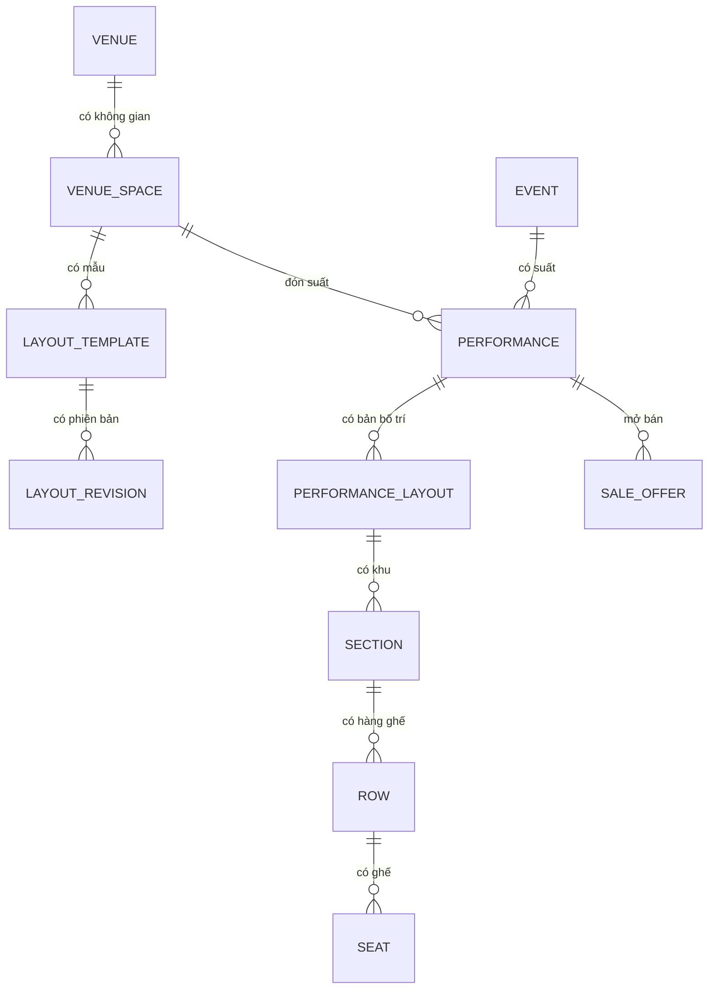

# Design

## Context

Catalog hiện xuất bản một Concert với một lịch, một chuỗi SVG và các ticket type. Ticketing giữ số lượng theo ticket type và chịu trách nhiệm về tính nhất quán giữa tồn kho, quota, đơn và phát hành. Check-in ghi nhận lượt vào theo vé và Concert. Các nguồn hiện hành gồm [cấu hình Concert](../../../services/catalog/src/main/java/org/ticketbox/catalog/concert/application/dto/CreateConcertRequest.java), [tính nhất quán mua vé](../../../docs/architecture.md#purchase-consistency), [ADR mô hình dịch vụ](../../../docs/adr/0001-service-domain-models.md) và [schema snapshot v1](../../../contracts/catalog.sale-snapshot.v1.json).

Ba hình tham khảo đại diện cho ba thao tác cần hỗ trợ. Hình 1 cho thấy chọn khu trên toàn sân. Hình 2 cho thấy chọn ghế khi zoom vào một khu, với danh sách ghế và trạng thái tương ứng. Hình 3 cho thấy cùng một mặt bằng có sàn GA và các khán đài. Các hình mô tả chức năng tham khảo. TicketBox dùng thiết kế giao diện của mình.

## Goals / Non-Goals

- Đợt đầu hỗ trợ nhiều suất, GA có hoặc không có sơ đồ, zone không đánh số, ghế đánh số và kết hợp các kiểu này trong cùng một suất. Bao gồm dựng sơ đồ nội bộ, giữ ghế nguyên tử, cập nhật khả dụng theo khu và danh sách dùng được bằng bàn phím. Hoãn và hủy áp dụng từng suất theo quy trình hiện có, còn trang Event tổng hợp trạng thái các suất.
- Một đơn thuộc một suất ở đợt đầu. Các mục mở rộng gồm pass nhiều suất, bán toàn bàn/box với các ghế con, tier theo mã hoặc nhóm khách phức tạp, vé miễn phí, resale, đổi ghế sau mua, sơ đồ 3D và tự động nhập CAD. Chúng cần quy tắc riêng về giá, tồn kho, hoàn, chuyển nhượng hoặc soát vé.
- Duy trì ranh giới dịch vụ hiện tại. Thiết kế này là bản đề xuất chờ review, gồm cả tên bảng và các điều kiện rollout. Quyết định được chấp thuận sẽ được ghi trong ADR trước triển khai.

## Decisions

### 1. Event, suất và phiên bản sơ đồ

Ba cách đã cân nhắc:

| Phương án | Đánh đổi |
|---|---|
| SVG riêng cho mỗi suất | Ít công thiết lập với sơ đồ tĩnh. Cần định danh ghế, ràng buộc tồn kho và công cụ kiểm tra riêng; phải làm lại mặt bằng ở các đêm tiếp theo. |
| Một sơ đồ cố định mỗi địa điểm | Tái sử dụng tốt khi bố trí luôn giống nhau. Đổi sân khấu, mở khu đứng hoặc khóa một số hàng đòi hỏi một cách lưu biến thể. |
| **Mẫu địa điểm có phiên bản + sơ đồ riêng của suất** | Đề xuất chọn. Tăng công xây editor và xuất bản, đổi lại tự do bố trí từng show, tái sử dụng được dữ liệu và liên kết được sơ đồ đã bán với đơn, vé và Check-in. |

Tên bảng dưới đây là tên logic. FK chỉ nối bảng trong cùng cơ sở dữ liệu. Catalog dùng UUID ổn định cho đối tượng đi qua hợp đồng. Giá và thời gian theo kiểu chính xác sẵn có, với `timestamptz` cho các mốc và timezone IANA để nhập và hiển thị theo giờ địa điểm. Catalog có thể dùng bảng quan hệ cho danh sách đối tượng và JSONB có schema version cho đường vẽ, tọa độ và style. Geometry có thể xuất thành tài sản cache được.

| Catalog | Khóa và trách nhiệm |
|---|---|
| `events` | `event_id`, `organization_id`, nội dung, đa ngôn ngữ, danh mục. Là trang khách khám phá. Không gian của một tour có thể khác ở từng suất. |
| `performances` | `performance_id`, `event_id`, `venue_space_id`, giờ bắt đầu/kết thúc, giờ mở cửa nếu có, timezone, trạng thái, giới hạn mua mỗi tài khoản và tham chiếu cấu hình đã xuất bản. Mỗi suất sở hữu cửa sổ bán, scope phòng chờ và cấp vào cửa. |
| `venues`, `venue_spaces` | Địa điểm và không gian bán vé độc lập, ví dụ phòng A và phòng B trong cùng nhà hát. Mẫu thuộc tổ chức hoặc được nền tảng chủ động cấp quyền dùng. Chọn một bản sao thuộc tổ chức của suất khi tùy chỉnh. |
| `layout_templates`, `layout_revisions`, `performance_layouts` | Mẫu chứa lịch sử phiên bản. Sơ đồ suất có thể tạo trống hoặc sao từ một `layout_revision_id`, ghi nguồn và giữ bản chụp riêng. Sau publish, suất ghim snapshot bất biến theo ID, số phiên bản và checksum. Các lượt publish nháp tranh nhau dùng expected revision để chặn ghi đè. |
| `sections`, `rows`, `seats` | Định danh ghế gắn với snapshot của suất. Khu có kiểu `GA` hoặc `ASSIGNED`. Hàng có nhãn và thứ tự hiển thị. Ghế có nhãn, vị trí, cờ tiếp cận, hạn chế tầm nhìn nếu có, đoạn ghế liền nhau và thứ tự trong đoạn. `UNIQUE(layout_id, section_code)`, `UNIQUE(section_id, row_code)`, `UNIQUE(row_id, seat_number)`. Vị trí ghế bắt buộc nằm trong khu hợp lệ khi đưa vào bán. |
| `inventory_groups` và thành viên | Khóa `(performance_id, group_id)`, loại `GA`/ `ASSIGNED`, `section_id` nếu có sơ đồ. Pool GA có sức chứa cấu hình dương. Nhóm ASSIGNED có danh sách ghế với `UNIQUE(performance_id, seat_id)` trên tập thành viên. |
| `sale_offers` | `offer_id`, `performance_id`, tên hạng, giá, tiền tệ, cửa sổ trong phạm vi mở bán và FK tới một nhóm tồn kho của chính suất. Đợt đầu dùng VND. Hạng giá tiêu chuẩn và early bird có thể chia sẻ một nhóm. Một vùng giá phủ hai khu dùng hai offer cùng nhãn hiển thị ở đợt đầu. |

Mỗi khu GA của suất có một pool. Suất GA đơn giản có một pool mặc định, kể cả khi không có tài sản sơ đồ. Với ghế đánh số, cấu hình xếp mỗi ghế bán được vào đúng một nhóm ghế của khu. Một khu có thể chia nhiều nhóm giá. Nhiều offer có thể dùng cùng một nhóm ở các cửa sổ khác nhau hoặc đồng thời. Không nhân bản tồn kho cho từng offer. Các lớp nền như sân khấu, lối đi, cột, cửa, nhãn và tiện ích không tham gia tồn kho. Khi suất đã xuất bản, thêm offer hoặc khóa bán thực hiện qua revision cấu hình bán có audit, giữ nguyên sơ đồ. Đợt đầu khóa sửa topology của suất đã publish; đổi sơ đồ do di dời cần quy trình xử lý riêng cho các quyền đã phát.

### 2. Tồn kho và giữ chỗ

Ticketing áp dụng bản cấu hình Catalog theo thứ tự và xác thực tham chiếu trong cơ sở dữ liệu của mình. Catalog gửi cấu hình sức chứa và đồ thị đối tượng, Ticketing cấp và kiểm soát tồn kho sử dụng được. Ticketing có các nhóm dữ liệu:

| Ticketing | Khóa và quy tắc |
|---|---|
| Cấu hình bán cục bộ | Phiên bản cấu hình theo `performance_id`, phiên bản sơ đồ, nhóm tồn kho và phạm vi hợp lệ của offer. Các bản tin lặp áp dụng một lần và bản cũ bị bỏ qua theo version. |
| `ga_inventory` | Một dòng mỗi `(performance_id, pool_id)`, lưu `total, available, held, allocated` với `CHECK` không âm và tổng bằng `total`. Cập nhật có điều kiện `available >= requested` trong transaction. |
| `seat_inventory` | Một dòng mỗi `(performance_id, seat_id)` cho ghế thuộc cấu hình suất. Ghế vận hành ở `AVAILABLE`, `HELD`, `ALLOCATED`, hoặc `BLOCKED`. `HELD` tham chiếu mục giữ chỗ, `ALLOCATED` tham chiếu dòng đơn cụ thể. Các cột chủ sở hữu tương ứng có CHECK và chỉ một chủ tại một thời điểm. Ghế `ALLOCATED` được giữ cho cả đơn chưa trả và đơn đã trả theo trạng thái của đơn. |
| `holds`, `hold_items` | Chủ tài khoản, phiên mua, suất, `expires_at`, phiên bản lựa chọn và khóa yêu cầu. Mỗi mục lưu offer và hoặc pool kèm số lượng dương hoặc một ghế. DB ràng buộc mỗi mục chỉ có một kiểu. |
| `orders`, `order_items` và vé | Đơn ghi suất, tổ chức, tiền tệ, hạn trả và khóa tạo đơn. Dòng GA giữ số lượng; mỗi ghế có dòng riêng với số lượng 1 và ID ghế. Cả hai chụp nhãn sự kiện, ngày giờ, khu, hàng, ghế, tên hạng và giá đã xác nhận ở nơi cần cho checkout, vé và báo cáo. V2 dùng định danh dòng hàng riêng, vì nhiều ghế cùng offer; đường v1 vẫn giữ khóa theo ticket type. |

Giữ giao diện mua nhỏ gồm cập nhật hold, đọc hold hiện tại, tiếp tục tạo đơn và giải phóng. Máy chủ xác thực phiên, scope suất và các phiên bản liên quan. Yêu cầu cấp mới hoặc thêm vé phải hợp lệ theo offer đang bán. Quota v2 đếm cả GA và ghế theo tài khoản và suất, gồm hold còn hiệu lực và các đơn đang chờ thanh toán hoặc đã trả tiền. Khi thay hold, thay đúng phần của hold đó trong phép tính. Chính sách quota lịch sử của v1 tiếp tục theo hạng. Số tiền đến từ cấu hình đã xác thực.

Khi máy chủ xác nhận hold, giá được chụp đến mốc sớm hơn giữa hạn hold và hạn bán của suất. Đổi giá hoặc tắt offer thông thường chỉ ảnh hưởng phần mua mới. Đình chỉ hay hủy suất chặn tạo đơn mới dù đã giữ. Sau khi tạo đơn, giá và hạn thanh toán theo đơn. Hủy, hoàn và đối soát đơn đã tạo tiếp tục theo chính sách hiện hành. Các chính sách giá và quota là đề xuất trong bản review này.

Đường giữ và chốt đơn mới dùng điều kiện ghi mode và trạng thái suất với khóa chia sẻ, giống guard hiện có. Đường thao tác đơn có sẵn tiếp tục khóa order trước guard người mua. Các thao tác thay hold, hết hạn, hủy và chốt đơn phải giữ thứ tự tương thích với các đường hiện hành, khóa cùng nhóm theo ID ổn định và kiểm tra chủ sở hữu bằng khóa có scope suất. So sánh deadline bằng giờ máy chủ sau khi lấy khóa cần thiết, xem đúng thời điểm deadline là hết hạn. Retry lỗi cạnh tranh có giới hạn và lặp lại cùng khóa thao tác. Không cập nhật một counter dùng chung cả suất trong mỗi lần giữ, để các khu độc lập có thể tiến song song. [Guard hiện có](../../../services/ticketing/src/main/java/org/ticketbox/ticketing/infrastructure/integration/catalog/TicketingCatalogProjection.java#L84) · [PostgreSQL 16 về khóa dòng](https://www.postgresql.org/docs/16/explicit-locking.html) · [PostgreSQL 16 về ràng buộc](https://www.postgresql.org/docs/16/ddl-constraints.html).

Một yêu cầu kết hợp hai ghế và bốn GA được xác nhận toàn bộ hoặc giữ nguyên lựa chọn cũ. Xung đột trả ghế hoặc pool vừa mất, lựa chọn còn hiệu lực và hướng tải lại. Phát lại khóa giữ thành công trả thông tin lần giữ đó và cho biết nếu đã hết hiệu lực. Khóa cũ với payload khác bị từ chối.

Chuyển từ hold sang allocated, ghi đơn, giá, quota, sự kiện vòng đời và publication liên quan trong một transaction Ticketing. Job hết hạn và callback tranh cùng tài nguyên qua ràng buộc hiện có và thời hạn của đơn. Late success sau khi đơn hết hạn đi vào đối soát, kể cả khi ghế đã thuộc người mua khác. Thanh toán trùng chỉ phát vé một lần. Hoàn tiền theo quy trình đã duyệt thu hồi vé mà không tự nhập lại tồn kho. Chỉ hỗ trợ mua mới ở nơi cấu hình bán cho phép. Redis kiểm soát hàng chờ và phiên mua. PostgreSQL primary quyết định mọi thay đổi stock. Chỉ dùng cache hoặc replica cho lượt đọc có thể chấp nhận độ trễ. [Quy trình hoàn tiền hiện hành](../order-support-and-event-refunds/design.md).

Index ban đầu bám truy vấn gồm `(event_id, starts_at, performance_id)` cho danh sách suất, `(performance_id, section_id, seat_id)` cho tồn kho từng khu, `(expires_at, performance_id, hold_id)` cho hold đang hoạt động, và chỉ mục tra quota theo người mua, suất và scope quy tắc bán. Dùng ID công khai sẵn của repo. Chỉ quyết định partition hoặc chia counter cho GA sau khi đo kế hoạch truy vấn, lock contention và ảnh hưởng đến FIFO/quota. Nhiều offer của một pool giữ cùng giới hạn cứng kể cả khi có nhiều instance Ticketing.

### 3. Dựng bản đồ và tương tác

1. Ban tổ chức chọn địa điểm, tạo sơ đồ từ trắng hoặc sao mẫu. Có thể tải ảnh mặt bằng tĩnh làm nền, vẽ polygon cho khu, đặt sân khấu/lối đi, sinh hàng ghế từ đoạn thẳng hoặc vòng cung, đổi số ghế và chia đoạn tại lối đi. Cột, ghế cản tầm nhìn và ghế tiếp cận được đánh dấu bằng metadata. Đợt đầu ưu tiên template, editor, ảnh nền và CSV có cấu trúc cho khu/hàng/ghế. SVG cũ tiếp tục phục vụ sự kiện cũ; SVG/CAD đưa vào editor cần một importer riêng.
2. Editor gắn mỗi khu/ghế với ID của snapshot suất. Một mặt bằng dùng một hệ tọa độ phẳng với kích thước hữu hạn và gốc xác định từ góc trên trái. CSV nhập cấu trúc có ID hoặc mã khu/hàng/ghế và tọa độ ghế trong hệ này. Hiện lỗi theo dòng trước khi áp dụng cả lô vào draft. Polygon chọn được trong cùng lớp không được chồng lấn mơ hồ, và đối tượng bấm được phải trỏ tới một ID hợp lệ. Lưu draft bằng optimistic version, xem trước trên mobile và desktop. Máy chủ kiểm tra tọa độ, nhãn trùng, vị trí ghế trong khu, tham chiếu offer, sức chứa và quyền sử dụng mẫu trước khi xuất bản. Ảnh nền xử lý theo chính sách upload của dự án. Preview riêng cho tổ chức, tài sản công khai chỉ phát hành theo quyền truy cập và phiên bản.
3. Khách chọn suất rồi thấy sơ đồ tổng thể và danh sách khu. Bấm khu GA mở chọn số lượng và hạng đang bán. Bấm khu ghế đánh số mở danh sách hàng/ghế và lớp sơ đồ chi tiết. Sơ đồ, bộ lọc và danh sách đọc cùng ID, vị trí và trạng thái. Có đường bàn phím/cảm ứng, nhãn chữ ngoài màu, focus thấy rõ và chọn tương đương bằng danh sách khi bản đồ tải lỗi. [WCAG 2.2 về thao tác bàn phím](https://www.w3.org/WAI/WCAG22/Understanding/keyboard.html).
4. Geometry tĩnh tải theo `layoutVersion`, cấu hình bán theo `saleVersion`, tình trạng tồn kho theo phần nhìn thấy. Mở tổng quan bằng dữ liệu gọn theo khu. Chỉ tải geometry và ghế của khu khi mở. Đợt đầu dùng HTTP theo khu với cache ngắn, ETag và điều nhịp refresh. Trình duyệt dùng thứ tự yêu cầu và định danh suất để loại phản hồi cũ, đồng thời tải lại khu sau xung đột. Có thể thêm cập nhật đẩy theo khu sau khi có số đo. Dùng SVG cho tổng quan. Chọn SVG hoặc Canvas cho lớp ghế sau khi đo với fixture sân lớn. Danh sách HTML hỗ trợ thao tác tương đương với cả hai cách render.
5. Tính năng chọn ghế gần nhau về sau dùng đoạn ghế và thứ tự lưu cùng sơ đồ, rồi thử giữ nhóm theo transaction giống chọn tay. Độ gần trên bản đồ và số ghế liên tiếp chưa đủ để đảm bảo không ngồi vắt qua lối đi.

### 4. Hợp đồng và quyền vào cửa

Các giao diện v2 dự kiến có đọc lịch suất, đọc sơ đồ công khai theo version, đọc tổng quan khả dụng và chi tiết theo khu, đường phòng chờ và giữ/chốt theo suất. Chỉ Ticketing chấp nhận hoặc từ chối giữ vé. Khách chọn offer cùng số lượng GA hoặc danh sách ID ghế và gửi mã giữ chỗ/phiên bản xác nhận khi tạo đơn. Một lỗi schema/version hướng về tải lại, một lỗi mất chỗ hướng về chọn lại. Preview, quản lý layout và thao tác sửa giá kiểm tra quyền theo tổ chức ở backend.

Catalog xuất snapshot cấu hình v2 qua cơ chế publication hiện có. Ticketing xác nhận áp dụng đầy đủ và khớp version trước khi mở mua. Nếu staged payload chia lô vì lớn, Ticketing lưu lô theo checksum và chỉ kích hoạt nguyên phiên bản khi đủ. Catalog và Ticketing phát trạng thái đồng bộ độc lập cho Check-in. Checkout không chờ Check-in ở từng đơn. V2 ticket snapshot mang `performance_id`, danh tính vé, hiệu lực và thông tin khu/hàng/ghế đã chụp. Check-in từ chối sai suất, xác nhận một lần theo vé và suất, dùng phân quyền scoped của Identity và giữ hành vi chờ xác nhận khi thiết bị offline. Soát QR v1 qua đường scoped sẽ dùng liên kết suất và cùng lịch sử lượt sử dụng, với định dạng QR v1 giữ nguyên. Trường hợp kiểm soát quyền theo nhiều cổng hoặc cho vào lại cần định nghĩa quyền và phạm vi đồng bộ trước khi áp dụng. Phiên mua v2 scope theo suất, dùng cơ chế phòng chờ thích ứng hiện có và giới hạn chung của Ticketing.

### 5. Mở rộng sau đợt đầu

| Nhu cầu | Thay đổi dự kiến khi ưu tiên |
|---|---|
| Festival nhiều ngày, season pass | Quyền vào trên từng suất/ngày và bảng liên kết gói với các suất. Định nghĩa cấp tồn kho và hoàn một phần kèm quy tắc từng suất trước khi bán gói. |
| Bàn, box, chỗ xe và ghế đi kèm | Tài nguyên cha/con và một quy tắc loại trừ. Cả bàn và ghế con phải tranh cùng quyền phân bổ nếu cùng mở bán. Bãi xe có thể là một pool riêng theo suất và không cần tọa độ ghế. |
| Triển lãm theo giờ hoặc lớp lặp | Tạo nhiều suất từ lịch lặp. Có thể thêm sức chứa dùng chung theo khoảng giờ nếu nghiệp vụ địa điểm yêu cầu. |
| Vé miễn phí, khách mời, khuyến mãi và presale kín | Cần hoàn tất 0 đồng và phát vé idempotent, quyền truy cập hoặc mã dùng theo điều kiện. Tách giá, quy tắc và stock giúp áp dụng trên cùng pool. |
| Khách dùng xe lăn và ghế đi kèm | Đợt đầu có loại ghế, nhãn và bộ lọc tiếp cận. Nếu địa điểm cần gắn cặp với điều kiện mua/ngồi, dùng cấu hình rõ và kiểm tra quan hệ trong cùng thao tác giữ. |
| Chuyển nhượng, bán lại, đổi ghế hoặc đổi mặt bằng | Giữ lịch sử quyền, khóa phân bổ đang mở, tái phát hành hoặc thay vé theo chính sách cần duyệt. Vé đã phát tiếp tục tham chiếu snapshot ban đầu cho đến khi thao tác thay đổi được xác nhận. |

## Risks / Trade-offs

- **Mở bán đông** → Đo riêng danh sách suất, bản đồ, giữ chỗ, checkout, callback và soát cổng. Sân 60.000 ghế là fixture kích thước dữ liệu. Kịch bản đề xuất lấy 75.000 người chờ từ hồ sơ thiết kế hiện có. Chốt profile đến, mục tiêu p95, tỷ lệ quá tải, tốc độ thanh toán và phần cứng trước nghiệm thu. Công bố năng lực theo kết quả đo. Có bài hotspot cho một pool GA và bài tranh cùng nhóm ghế.
- **Giao dịch nửa chừng** → Kiểm thử xung đột hold, vô hiệu offer, hết phiên, job hết hạn, callback trùng hoặc đến muộn, mất phản hồi tạo đơn, rollback đủ mọi cập nhật. Kiểm tra tổng stock và số ghế trùng sau mỗi bài tải.
- **Sơ đồ hoặc giá lệch phiên bản** → Đối chiếu layout version, sale version và ID suất trong phản hồi. Snapshot hình học có cache riêng, tồn kho đọc theo khu; giao diện báo lỗi và đồng bộ theo xác nhận của server.
- **Soát vé tại địa điểm** → Luồng staff hiện bị chặn theo [ADR quyền tổ chức](../../../docs/adr/0002-organization-ownership.md). Rollout thật phụ thuộc change phân quyền nhân viên theo suất, diễn tập offline có đối chiếu và xác thực cổng thanh toán.

## Migration Plan

1. Thêm migration Flyway cho từng service, schema/hợp đồng v2 và các bộ chuyển đọc v1 trong bước tương thích. Triển khai các receiver và guard ghi tương thích ở tất cả worker trước khi Catalog phát v2. Chạy backfill idempotent, kiểm tra số suất, ID, lịch sử đơn, QR và tổng tồn kho. Ánh xạ mỗi Concert cũ sang đúng một Event và một Performance, với `legacy_concert_id` duy nhất và cùng UUID cũ trong hai bảng có phạm vi riêng. Giữ URL, API mua và QR v1. Tạo hiển thị từ dữ liệu cũ, trong đó SVG cũ chỉ phục vụ chọn hạng. Thiếu tổ chức hoặc bản đồ tiếp tục theo quyền và hành vi cũ.
2. Chế độ ghi được lưu theo suất trong PostgreSQL Ticketing. V1 reserve, release và create order cùng V2 kiểm tra chế độ trong transaction. Chuyển chế độ bằng thao tác có khóa độc quyền trên guard của suất và kiểm tra version, song song với các giao dịch giữ khóa chia sẻ khi ghi. Concert đã xuất bản tiếp tục v1. Concert nháp chỉ chuyển nếu xác minh chưa từng mở bán và chưa có hold/đơn/vé. V2 được dùng thử cho suất mới với fixture GA, zone, ghế và hybrid rồi từng tổ chức. Cờ triển khai điều khiển hiển thị và rollout. Chế độ đã kích hoạt trong database mới quyết định quyền ghi.
3. Trước khi kích hoạt v2, có thể tắt cờ ở suất thử. Chế độ v2 đã kích hoạt được giữ kể cả sau khi restart hoặc tắt cờ. Khi rollback vận hành, dừng nhận giao dịch mới tại suất lỗi, giữ worker hết hạn, thanh toán, đối soát, phát vé và soát vé đang hoạt động, rồi khôi phục phiên bản hiểu dữ liệu v2. Không đưa ghế đã giữ hoặc đã bán vào pool v1. Đối chiếu và diễn tập restore trước khi có kế hoạch loại bỏ v1.

## Open Questions

- Chọn địa điểm và nguồn mặt bằng được cấp phép cho fixture thử editor và cho pilot. Bản vẽ thật giúp đo công nhập liệu; mẫu tổng hợp giúp kiểm thử độc lập.
- Chốt ngưỡng nghiệm thu định lượng theo môi trường triển khai với số đo baseline và hạn mức merchant. Bản này đề xuất GA/hybrid mới theo rollout tăng dần, với cổng quyết định riêng trước khi dùng cho đợt mở bán lớn.
